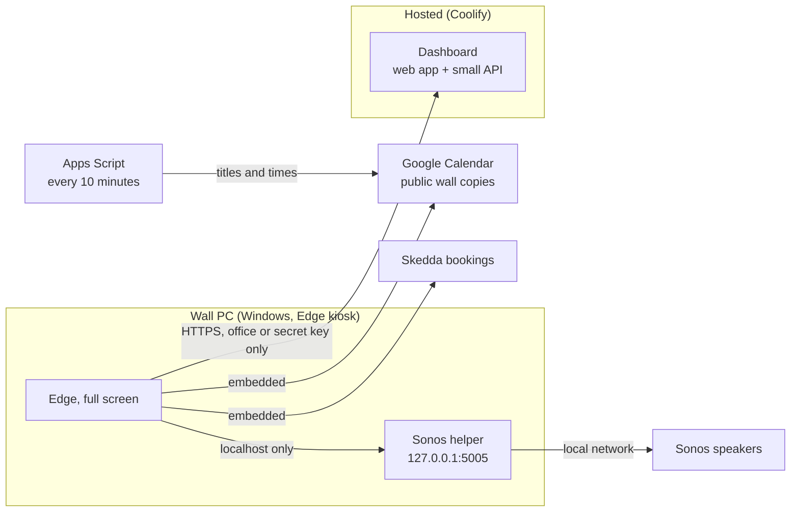

# Inspire9 Wall

A touch-friendly wall dashboard for a coworking space: the calendar, room bookings and Sonos music controls on one screen, running full screen on a Windows PC.



| Folder | What it is |
|---|---|
| [`dashboard/`](dashboard) | The web app the wall shows, and its small API (Vite, React, Hono) |
| [`music/`](music) | Sonos control over the local network, shared by the dashboard (local mode) and the helper |
| [`helper/`](helper) | The Windows service on the kiosk PC that lets the dashboard control Sonos |
| [`windows/`](windows) | PowerShell scripts that set up the kiosk PC and install the helper |
| [`apps-script/`](apps-script) | Google Apps Script that keeps public title-and-time copies of the office calendars |

## Using the screen

- **Layout** button (top right): Auto, Large left, Large right, Side by side, Stacked.
- **Drag a panel's title bar** onto another panel to swap them. Drag the handles between panels to resize.
- Each panel has **zoom** out and in (tap the percentage to go back to 100%), **minimise** and **expand**. An expanded panel goes back to the board by itself after a while.
- **Tap the time** for 24 hour time, **tap the date** to change its format.
- **Music**: play, pause and skip; each speaker's volume (with limits); the queue (tap to jump, drag to reorder, remove). Expand the panel for Favourites, Playlists and Recently played. Tap one to open it, then Play, Shuffle or the **…** menu (Play now, Play next, Add to end of queue, Replace queue).
- Layout, panel order, zoom and clock formats are saved on the server, so they survive the browser being reset.

## Run it locally

```sh
npm install
cp dashboard/.env.example dashboard/.env.local   # then fill it in
pm2 start ecosystem.config.cjs                    # or: npm run dev
```

The dashboard is on http://localhost:5191. On the office network, music works straight away (local mode: the dashboard's own server talks to Sonos). `pm2 start ecosystem.config.cjs --only inspire9-wall-helper` runs the helper on your machine too, for testing it.

## Settings

All in `dashboard/.env.local` locally, or the app's environment variables on Coolify.

| Setting | Purpose |
|---|---|
| `GCAL_EMBED_URL` | Google Calendar embed link: one `src=` and `color=` per calendar (the public copies, see below) |
| `SKEDDA_URL` | Public Skedda booking view |
| `ALLOWED_IPS` | The office's public internet address(es), comma separated |
| `ACCESS_KEY` | Long random secret; opening the dashboard with `?key=<this>` remembers that browser |
| `TRUST_PROXY` | `1` behind a reverse proxy such as Coolify's (the default in production) |
| `MUSIC_SOURCE` | `local` (dev default), `helper` (production default) or `off` |
| `MUSIC_HELPER_URL` | The helper as the kiosk browser sees it, `http://127.0.0.1:5005` |
| `MUSIC_MAX_VOLUME` | Highest volume the wall sets on any speaker (local mode; default 85) |
| `MUSIC_SPEAKER_LIMITS` | Lower limits by speaker name: `Kitchen=60, Lobby=50` (local mode) |
| `SONOS_HOSTS` | Speaker IPs to try before network discovery (optional) |
| `DATA_DIR` | Where the saved layout lives (a persistent volume in production) |

## Who can see it

Every request is checked on the server before anything is sent, so a visitor who isn't allowed gets a short "not available" page and nothing else: no page, scripts or data.

- From the office's internet address (`ALLOWED_IPS`), it just works.
- Anywhere else, open it once with the secret link, `https://<dashboard>/?key=<ACCESS_KEY>`. The browser gets a signed cookie (never the key itself), the key is taken out of the address bar, and the browser is remembered for about a year. Changing `ACCESS_KEY` signs every remembered browser out.
- Wrong keys are rate limited. In production, with neither setting, nobody gets in.

## Deploy (Coolify)

The repo deploys as a Dockerfile app on port 3000, with a persistent volume at `/data` and the health check on `/api/health`. A GitHub webhook to Coolify redeploys on every push to `main`.

## Calendar

The calendar panel embeds Google Calendar's own view. Google has no private embed link, so [`apps-script/wall-calendar-sync.gs`](apps-script/wall-calendar-sync.gs), running in the Google account that owns the calendars, keeps a public "Wall: ..." copy of each office calendar with titles and times only (no descriptions, guests, locations or meeting links; private events show as "Busy"), synced every 10 minutes. One copy per calendar, because the embed colours whole calendars rather than events.

To set it up, paste the script into a new project at script.google.com, fill in `SOURCES`, add the Google Calendar API service, and run `setup`. It logs the embed link to use as `GCAL_EMBED_URL`.

## The kiosk PC

The PC runs Edge in kiosk mode under a standard local account (`Calendar` by default), signed in automatically. A colleague can remote desktop in under their own account; when they're done, the kiosk comes back to the screen by itself. The Sonos helper runs as a Windows service, whoever is signed in.

### Set it up

On the PC, signed in with an administrator account:

1. Open **PowerShell as administrator** (Start, type PowerShell, right-click, Run as administrator).
2. Download the setup script and run it:

   ```powershell
   cd $env:TEMP
   Invoke-WebRequest https://github.com/TalkingSites/inspire9-wall/releases/latest/download/setup-kiosk.ps1 -OutFile setup-kiosk.ps1 -UseBasicParsing
   powershell -ExecutionPolicy Bypass -File .\setup-kiosk.ps1 -DashboardUrl https://wall.example.com -SpeakerLimits "Kitchen=60" -EnableAutologon
   ```

   It asks for a password for the kiosk account the first time. It then sets up:

   | Part | What it does |
   |---|---|
   | Kiosk account | A standard local account (no admin rights) |
   | Edge | No first-run, restore or translation prompts, nothing running in the background, and the dashboard allowed to reach the helper without a prompt (`LoopbackNetworkAllowedForUrls`, `LocalNetworkAccessAllowedForUrls`) |
   | Kiosk browser | At the kiosk account's sign-in, Edge opens the dashboard full screen, and opens it again if it's closed or crashes |
   | Return to kiosk | A task running as SYSTEM, on remote desktop sign-out or disconnect (events 23 and 24) and every 5 minutes: reconnects the kiosk session to the screen with `tscon`, unless a remote desktop session is active or someone else is signed in at the PC |
   | Power | The PC stays on. The display is on from 7:30am to 5pm every day (`-WakeAt` and `-SleepAt` to change), waking the PC if it ever sleeps; outside those hours it turns off after 5 minutes without a touch (`-NightScreenMinutes`). No password is asked for when the display or PC wakes. The hidden "console lock display off timeout" is shown and raised to an hour |
   | Automatic sign-in | With `-EnableAutologon`: Microsoft's Sysinternals Autologon, which stores the password encrypted |
   | Sonos helper | Installed as a service (below), updating itself weekly |

3. Restart the PC. It signs in as the kiosk account and opens the dashboard.
4. The first time, tap **Decline** on the Skedda usage-data banner.

The office's internet address must match `ALLOWED_IPS`. If it ever changes, open the secret link once on the kiosk.

### Without the script

If you'd rather set up automatic sign-in by hand: download [Autologon](https://learn.microsoft.com/sysinternals/downloads/autologon) from Microsoft, run it as administrator, enter the kiosk account and its password, and click Enable.

### The Sonos helper

[`windows/install-helper.ps1`](windows/install-helper.ps1) downloads the latest helper from GitHub Releases and runs it as a Windows service with [WinSW](https://github.com/winsw/winsw): it starts at boot without anyone signed in, restarts if it crashes, and keeps rotating log files (1 MB, five kept) in `C:\ProgramData\Inspire9 Wall Helper\logs`. It adds a firewall rule so Sonos discovery works on the local network.

```powershell
.\install-helper.ps1 -DashboardUrl https://wall.example.com -MaxVolume 85 -SpeakerLimits "Kitchen=60" -WeeklyUpdate
```

**Re-running it is the update process**; settings are kept, so later runs need no parameters. `-WeeklyUpdate` adds a task that does this every Sunday at 3am.

The helper listens on `127.0.0.1:5005` only. It answers only the dashboard's own address (other websites can't read or control anything, and DNS rebinding is refused), and it never changes Sonos grouping: it controls the biggest group that isn't playing AirPlay, line-in or TV.

## Releases

Pushing a version tag (`git tag v1.2.3 && git push origin v1.2.3`) runs [`.github/workflows/helper.yml`](.github/workflows/helper.yml): it builds the helper into a single Windows `.exe` with Bun and publishes a release with it and the `windows/` scripts. Run the workflow by hand to check the build without publishing.

## Troubleshooting

| Problem | Look at |
|---|---|
| "Music controls unavailable" | Is the helper running? `Get-Service inspire9-wall-helper` on the PC, and its logs in `C:\ProgramData\Inspire9 Wall Helper\logs` |
| The kiosk doesn't come back after remote desktop | `C:\ProgramData\Inspire9 Wall Kiosk\return-kiosk.log`, and the "Inspire9 Wall return to kiosk" task in Task Scheduler |
| "This screen isn't available at this location" on the kiosk | The office's internet address has changed: update `ALLOWED_IPS`, or open the secret link once on the kiosk |
| The calendar is missing events | The Apps Script's executions at script.google.com (it syncs every 10 minutes) |
